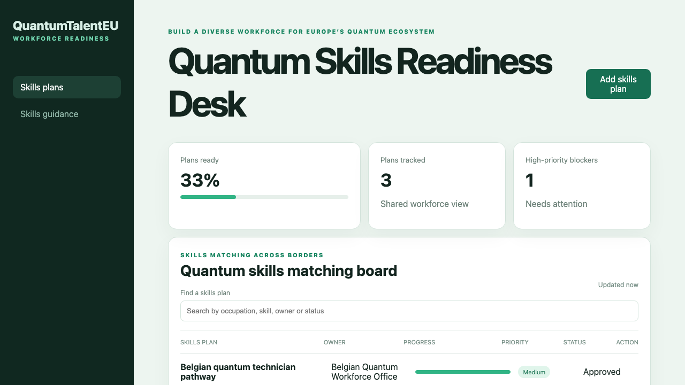

# Quantum Skills Readiness Desk

## One-sentence benefit
Helps employers and mobility teams connect quantum learning with quantum roles across Europe.

## Live demo
Run the Java service and Vue application locally to use the complete experience.

## Screenshots

## Main features
Search skills plans, add a realistic pilot, progress work, inspect priorities and open a dedicated skills guidance page.

## Technology used
Vue, TypeScript, Pinia, Vue Router, Vite, Spring Boot and Java.

## Installation instructions
Start the backend with `cd backend && mvn spring-boot:run`. In another terminal run `npm install && npm run dev`.

## Commercial licensing/contact
Commercial licensing and implementation support are available through the repository owner.

## Business problem and users
Employers, migration services and labour-market teams need a clear way to coordinate quantum roles, candidate support and accountable owners.

## Key workflows
Users can filter plans, create a Brussels pilot, move a plan forward and review practical guidance.

## Vue framework highlights
The application uses the Composition API, Pinia computed state, reactive filters and Vue Router pages.

## Java backend highlights
The Spring Boot service provides real list, search, create and update endpoints, validation, clear errors, health reporting and tests.

## Architecture and state flow
Pinia owns the shared client state and synchronises it with the Java API after reads and writes.

## Accessibility and responsive behaviour
Landmarks, labels, visible focus, readable status text and responsive panels support keyboard and mobile users.

## Verification commands
Use `npm test`, `npm run build`, and `cd backend && mvn test package`.

## Structure
`src` contains the Vue experience, `backend` contains the Java service, and `docs` contains verified media.

## Tradeoffs
The demonstration uses an in-memory data store; production deployment would add authentication, persistence and recruitment-system integrations.

## Roadmap
Add multilingual profiles, qualification mapping, consent controls, employer verification and durable storage.
